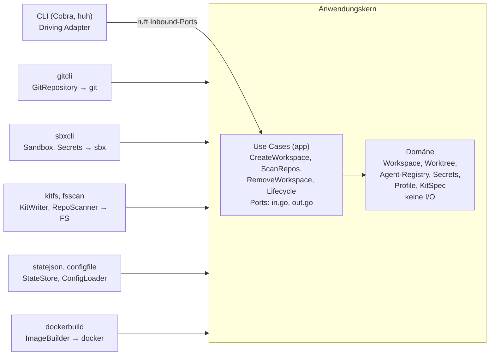

# boxai – Building Plan: Multi-Repo Worktree Workspaces in Docker Sandboxes

Stand: 2026-11-03 · Jan

## Zweck und Kontext

`boxai` ist ein Go-CLI, das mehrere Git-Repos als Worktrees zu einem Workspace bündelt und diesen Workspace in einer Docker Sandbox (`sbx`, microVM) mit einem wählbaren Coding-Agent startet. Ziel: Ein Agent arbeitet repo-übergreifend (z. B. Kotlin-Backend plus React-Frontend), isoliert vom Host, mit vorkonfigurierten Tools, Secrets und den Agent- und Skill-Dateien aus den Repos.

**Hinweis an Claude Code:** Dieser Plan ist die verbindliche Spezifikation. Arbeite die Phasen in Abschnitt "Implementierungsphasen" der Reihe nach ab und halte nach jeder Phase an, damit sie reviewt werden kann. Wo der Plan "zu verifizieren" sagt, prüfe das reale Verhalten von `sbx` lokal (`sbx --help`, `sbx <cmd> --help`), bevor du Code darauf aufbaust. Jede Entscheidung, Erkenntnis und Architekturänderung landet als Konzept im OKF-Bundle des Repos (Abschnitt "Dokumentation mit OKF"); das Bundle ist Teil der Definition of Done jeder Phase.

Rahmen:

- **Sprache:** Go (aktuelle stabile Version), ein statisches Binary, Linux und macOS als Zielplattformen.
- **Architektur:** hexagonal (Ports and Adapters). Domäne und Use Cases kennen weder `git`, `sbx`, Dateisystem noch CLI.
- **Docker-Anbindung:** über das `sbx`-CLI als Subprozess, gekapselt in einem Outbound-Adapter. Das Docker-Engine-SDK steuert keine sbx-microVMs.
- **Git-Anbindung:** über das `git`-CLI als Subprozess, gekapselt in einem Outbound-Adapter. go-git unterstützt bei Worktrees nur `add` vollständig, die API ist experimentell.
- **Dokumentation:** Open Knowledge Format (OKF), Markdown-Konzepte mit YAML-Frontmatter, in CI gelintet.
- **Nicht im Scope (v1):** Cloud-Sandboxes, GUI, automatisches Erstellen von Merge Requests.

## Hintergrund: Docker Sandboxes (sbx)

Docker Sandboxes starten jeden Agent in einer eigenen microVM mit eigenem Kernel, eigenem Docker-Daemon und einem Proxy, der Netzwerk und Credentials kontrolliert. Für `boxai` sind diese Eigenschaften tragend ([Docs](https://docs.docker.com/ai/sandboxes/), [Kits v2](https://docs.docker.com/ai/sandboxes/customize/kits-v2/), [Usage](https://docs.docker.com/ai/sandboxes/usage/), [Credentials](https://docs.docker.com/ai/sandboxes/security/credentials/)):

| Thema | Verhalten laut Doku | Konsequenz für boxai |
| --- | --- | --- |
| Workspaces | Erster Pfad = primärer Workspace; weitere Pfade werden zusätzlich gemountet, alle unter ihrem absoluten Host-Pfad; `:ro` für read-only. Beispiel: `sbx create claude . /path/to/docs:ro` | Workspace-Ordner als primären Pfad mounten; Haupt-Repos für Worktree-Metadaten als Zusatzpfade |
| Built-in Agents | `claude`, `codex`, `copilot`, `docker-agent`, `droid`, `gemini`, `kiro`, `opencode`, `shell` | Claude Code und Copilot sind direkt nutzbar. **Antigravity ist kein Built-in** und braucht einen eigenen Kit |
| Templates | `--template <image>` ersetzt das Image eines Built-in-Agents; Basis `docker/sandbox-templates:<variant>`, `-docker`-Varianten enthalten Docker Engine. Registry-Domain muss angegeben werden | Eigene Images je Stack (Kotlin, React) auf Basis der Agent-Templates |
| Kits (v2) | `spec.yaml` + `files/`; `files/home/` landet in `/home/agent/`, `files/workspace/` im primären Workspace; `setup.install`, `setup.startup`, `setup.files`, `environment.variables`, `permissions.network`, `credentials` | boxai generiert pro Sandbox einen Mixin-Kit mit Agent/Skill-Dateien, Env und Netzwerkregeln |
| Reservierte Pfade | z. B. `~/.claude.json`, `~/.claude/settings.json`, `~/.copilot/config.json` sind sandbox-managed | Diese Dateien nie überschreiben, nur Skills, Agents, Commands kopieren |
| Secrets | `sbx secret set [-g] <service>` (OS-Keychain), `sbx secret set-custom --host <h> --env <VAR> --value <v>` (experimentell). Sandbox sieht nur einen Platzhalter, der Proxy ersetzt ihn beim Request an den Host | Secrets aus `.env`/YAML auf `set-custom` mit `--sandbox <name>` abbilden, nicht als Klartext in die Sandbox schreiben |
| Registry-Auth | `sbx secret set --registry <host>` für private Template-Images | Für eigene Images in privater Registry nötig |
| Netzwerk | Default-Policy restriktiv; `sbx policy allow network "host:443"` bzw. `permissions.network.allow` im Kit | Maven-, npm-, Git-Hosts pro Profil freischalten |
| Dateien kopieren | `sbx cp <src> <sandbox>:<path>` | Fallback, falls Kit-Dateien nicht reichen |

Zwei Fallstricke prägen das Design:

1. **Worktrees in Sandboxes:** Die `.git`-Datei eines Worktrees enthält einen absoluten Host-Pfad ins Haupt-Repo. Ohne dass das Haupt-Repo (mindestens dessen `.git`) unter demselben Pfad gemountet ist, schlägt jedes Git-Kommando in der Sandbox fehl. Da sbx Zusatzpfade unter ihrem absoluten Host-Pfad mountet, löst boxai das, indem es die Haupt-Repos als zusätzliche Workspaces übergibt.
2. **Experimentelle Features:** `set-custom`, Kits v3 und Teile des Branch- und Clone-Modus sind als experimentell markiert. In der hexagonalen Architektur betrifft das nur den sbx-Adapter; Domäne und Use Cases bleiben unberührt.

## Funktionale Anforderungen

| ID | Anforderung | Details |
| --- | --- | --- |
| F1 | Repo-Scan | Startet im aktuellen Verzeichnis oder in `--dir <pfad>`. Findet Git-Repos rekursiv (Verzeichnis mit `.git`-Ordner), konfigurierbare Tiefe (Default 3), überspringt `node_modules`, `build`, `target`, `.gradle`, `vendor` und versteckte Ordner. Bare-Repos und bestehende Worktrees werden erkannt und nicht als eigenständige Repos gelistet |
| F2 | Remote-Repos | Optional zusätzlich Repos per URL (GitHub/GitLab, HTTPS oder SSH) klonen, in einen Cache-Ordner `~/.boxai/repos/<host>/<owner>/<repo>`. Vorhandene Clones werden per `git fetch` aktualisiert |
| F3 | Auswahl | Interaktive Multi-Select-Liste (Name, Pfad, aktueller Branch, Dirty-Status). Nicht-interaktiv über `--repo <name>` (mehrfach) oder Workspace-Datei |
| F4 | Worktrees | Pro gewähltem Repo ein `git worktree add` in `<workspace-root>/<workspace-name>/<repo-name>`. Default-Root `~/boxai-workspaces`, überschreibbar mit `--root`. Branch: neu (`-b <branch>`, Default `boxai/<workspace-name>`) von `--base` (Default: Default-Branch des Repos) oder bestehender Branch per `--checkout` |
| F5 | Sandbox | Erstellt eine sbx-Sandbox mit dem Workspace-Ordner als primärem Workspace und den Haupt-Repos als zusätzliche Mounts (Worktree-Fix) |
| F6 | Agent-Wahl | `claude` (Claude Code), `copilot` (GitHub Copilot CLI), `antigravity` (Google Antigravity, über eigenen Kit). Interaktiv oder `--agent` |
| F7 | Agent- und Skill-Dateien | Sammelt aus allen gewählten Repos Agent-, Skill- und Command-Dateien und legt sie im Home der Sandbox ab (Zielpfade je Agent, siehe Ablauf "Agent-Dateien"). Konflikte gleichnamiger Dateien werden mit Repo-Präfix aufgelöst und gemeldet |
| F8 | Secrets | `.env`- oder YAML-Datei mit Secrets (z. B. Maven-Repo, npm-Registry, Git-Token, AWS). Werden über den sbx-Secret-Store pro Sandbox hinterlegt, nicht als Klartext in Dateien der Sandbox |
| F9 | Stack-Profile | Mitgelieferte Profile `kotlin-spring` und `react`, kombinierbar. Steuern Image, Netzwerk-Freigaben und Konfigurationsdateien (Gradle/Maven, npm) |
| F10 | Eigene Images | `--image <ref>` oder `--dockerfile <pfad>` (wird lokal gebaut und per `sbx template load` geladen). Muss auf dem passenden Agent-Template basieren |
| F11 | Default-Tools | In allen mitgelieferten Images: `git`, `gh`, `glab`, `aws` (AWS CLI v2), `jq`, `curl` |
| F12 | Lifecycle | `boxai list`, `boxai attach <name>`, `boxai stop <name>`, `boxai rm <name>` (entfernt Sandbox und Worktrees; Branches bleiben, außer `--delete-branches`). Zustand in `~/.boxai/state/<name>.json` |
| F13 | Dry-Run | `--dry-run` zeigt alle geplanten git- und sbx-Kommandos, ohne sie auszuführen |
| F14 | OKF-Kontext der Repos | Enthält ein gewähltes Repo ein OKF-Bundle (Ordner mit `index.md` und Konzepten mit `type`-Frontmatter, z. B. `.okf/`), verweist die generierte Root-`AGENTS.md` darauf, damit der Agent den Projektkontext zuerst liest |

Nicht-funktional: idempotente Schritte (erneutes `up` setzt fort statt zu duplizieren), Rollback bei Fehler nach Worktree-Anlage, strukturierte Logs (`--verbose`), keine Secrets in Logs oder State-Dateien.

## Architektur: hexagonal (Ports and Adapters)

Domäne und Use Cases bilden den Kern und definieren Ports als Go-Interfaces; alles, was Prozesse startet oder Dateien anfasst, ist ein Adapter außen. Abhängigkeiten zeigen nur nach innen: `adapter → app → domain`. Verdrahtet wird ausschließlich im Composition Root `cmd/boxai/main.go`.



Pfeile zeigen die Abhängigkeitsrichtung: Adapter implementieren Ports des Kerns.

| Schicht | Inhalt | Darf importieren |
| --- | --- | --- |
| `domain` | Entitäten, Value Objects, reine Regeln: Workspace, RepoRef, Worktree, BranchStrategy, AgentKind, AssetMapping, SecretSpec, Profile, SandboxSpec, KitSpec. Keine I/O | nur Standardbibliothek (ohne `os`, `os/exec`, `net`) |
| `app` (Use Cases) | `CreateWorkspace` (up), `ScanRepos`, `AttachWorkspace`, `StopWorkspace`, `RemoveWorkspace`, `ListWorkspaces`, `Doctor`. Orchestrieren Domäne über Ports, inkl. Rollback | `domain`, `app/port` |
| `app/port` | Inbound-Ports (Use-Case-Interfaces) und Outbound-Ports (siehe unten) | `domain` |
| `adapter/in` | Driving Adapter: CLI (Cobra + huh) | `app/port`, `domain` |
| `adapter/out` | Driven Adapter: git-CLI, sbx-CLI, Dateisystem, Docker-Build, YAML/.env, State-JSON | `app/port`, `domain`, Drittbibliotheken |

```text
boxai/
├── cmd/boxai/main.go                # Composition Root: Adapter erzeugen, Use Cases verdrahten
├── internal/
│   ├── domain/
│   │   ├── workspace/               # Workspace, RepoRef, Worktree, BranchStrategy
│   │   ├── agent/                   # AgentKind, AssetMapping, ReservedPaths, Registry
│   │   ├── secret/                  # SecretSpec, Redaction-Regeln
│   │   ├── profile/                 # Profile, NetworkRule, ConfigFile
│   │   └── sandbox/                 # SandboxSpec, KitSpec (reines Modell, kein YAML)
│   ├── app/
│   │   ├── port/
│   │   │   ├── in.go                # Inbound-Ports
│   │   │   └── out.go               # Outbound-Ports
│   │   ├── createworkspace/         # Use Case "up" inkl. Rollback-Stack
│   │   ├── scanrepos/
│   │   ├── removeworkspace/
│   │   ├── lifecycle/               # attach, stop, list
│   │   └── doctor/
│   └── adapter/
│       ├── in/cli/                  # Cobra-Kommandos, Flags, huh-Prompts
│       └── out/
│           ├── gitcli/              # GitRepository via git-Binary
│           ├── sbxcli/              # SandboxRuntime + SecretStore via sbx-Binary
│           ├── kitfs/               # KitWriter: spec.yaml + files/ auf Platte
│           ├── fsscan/              # RepoScanner via filepath.WalkDir
│           ├── dockerbuild/         # ImageBuilder (docker build + sbx template load)
│           ├── configfile/          # ConfigLoader: boxai.yaml, Secrets (.env/YAML)
│           ├── statejson/           # StateStore: ~/.boxai/state/*.json
│           └── execx/               # gemeinsamer Subprozess-Runner (Dry-Run, Logging, Redaction)
├── images/                          # Dockerfiles der mitgelieferten Templates
├── kits/antigravity/                # Sandbox-Kit für Antigravity
├── .okf/                            # OKF-Bundle (Projektdokumentation)
├── AGENTS.md                        # Einstieg für Agents, verweist auf .okf/index.md
└── testdata/
```

Outbound-Ports (Skizze, `internal/app/port/out.go`):

```go
type RepoScanner interface {
    Scan(ctx context.Context, root string, depth int) ([]workspace.RepoRef, error)
}

type GitRepository interface {
    DefaultBranch(ctx context.Context, repo string) (string, error)
    CurrentBranch(ctx context.Context, repo string) (string, error)
    IsDirty(ctx context.Context, repo string) (bool, error)
    Clone(ctx context.Context, url, dest string) error
    Fetch(ctx context.Context, repo string) error
    AddWorktree(ctx context.Context, wt workspace.Worktree) error
    RemoveWorktree(ctx context.Context, wt workspace.Worktree, force bool) error
    DeleteBranch(ctx context.Context, repo, branch string) error
    CommonDir(ctx context.Context, worktreePath string) (string, error)
}

type SandboxRuntime interface {
    Create(ctx context.Context, spec sandbox.SandboxSpec) error
    Attach(ctx context.Context, name string) error // interaktiv, stdin/stdout durchreichen
    Stop(ctx context.Context, name string) error
    Remove(ctx context.Context, name string) error
    List(ctx context.Context) ([]sandbox.Info, error)
    AllowNetwork(ctx context.Context, name string, rules []profile.NetworkRule) error
}

type SecretStore interface {
    Put(ctx context.Context, sandboxName string, s secret.SecretSpec) error
    DeleteAll(ctx context.Context, sandboxName string) error
}

type KitWriter interface {
    Write(ctx context.Context, kit sandbox.KitSpec, dir string) error
    Validate(ctx context.Context, dir string) error
}

type AssetSource interface { // liest Agent/Skill-Dateien aus einem Worktree
    Collect(ctx context.Context, worktreePath string, mappings []agent.AssetMapping) ([]agent.Asset, error)
}

type ImageBuilder interface {
    BuildAndLoad(ctx context.Context, dockerfile, tag string) (string, error)
}

type ConfigLoader interface {
    LoadWorkspaceConfig(ctx context.Context, path string) (WorkspaceConfig, error)
    LoadSecrets(ctx context.Context, path string) ([]secret.SecretSpec, error)
}

type StateStore interface {
    Save(ctx context.Context, st WorkspaceState) error
    Load(ctx context.Context, name string) (WorkspaceState, error)
    List(ctx context.Context) ([]WorkspaceState, error)
    Delete(ctx context.Context, name string) error
}

type Prompter interface { // vom CLI-Adapter implementiert, für interaktive Auswahl
    SelectRepos(ctx context.Context, repos []workspace.RepoRef) ([]workspace.RepoRef, error)
    SelectAgent(ctx context.Context, options []agent.AgentKind) (agent.AgentKind, error)
}
```

Regeln:

- Die Agent-Registry (Asset-Mappings, reservierte Pfade, Default-Template je Agent) liegt in `domain/agent` als Daten, nicht in einem Adapter. Erweiterungen aus `~/.boxai/config.yaml` werden vom ConfigLoader gelesen und in die Registry gemerged.
- Die Übersetzung von `KitSpec` nach `spec.yaml` (Schema v2) gehört in `kitfs`; die Domäne kennt kein sbx-YAML.
- Use Cases erhalten Ports per Konstruktor (`createworkspace.New(git, sbx, secrets, kit, ...)`), keine globalen Variablen, kein DI-Framework.
- Die Abhängigkeitsregel wird geprüft: `depguard` in `golangci-lint` und ein Architekturtest (`go list -deps` über `internal/domain` und `internal/app` darf keine `adapter`-Pakete und kein `os/exec` enthalten).
- Tests der Use Cases laufen ausschließlich gegen In-Memory-Fakes der Ports (`internal/app/port/porttest`).

Bibliotheken (nur in Adaptern): `spf13/cobra`, `charmbracelet/huh`, `joho/godotenv`, `gopkg.in/yaml.v3`; `log/slog` überall. Keine Abhängigkeit auf das Docker-SDK in v1.

## Dokumentation mit OKF

Die gesamte Projektdokumentation von boxai liegt als OKF-Bundle im Ordner `.okf/`: ein Verzeichnis von Markdown-Dateien, jede Datei ein Konzept mit YAML-Frontmatter. Laut [OKF-Spezifikation](https://github.com/GoogleCloudPlatform/open-knowledge-format/blob/main/SPEC.md) ist nur das Feld `type` Pflicht; boxai legt zusätzlich `title`, `tags` und `status` als Konvention fest. Es gibt keine separate `docs/adr/`-Ablage und keine Doku außerhalb des Bundles, außer `README.md` (Installation, Kurzstart) und `AGENTS.md` (Einstieg für Agents).

```text
.okf/
├── index.md                               # Einstieg: was boxai ist, Links auf alle Bereiche
├── log.md                                 # Änderungshistorie, ISO-datiert, neueste zuerst
├── overview.md                            # Ziel, Scope, Nicht-Ziele
├── architecture/
│   ├── hexagonal.md                       # type: Architecture – Schichten, Abhängigkeitsregel
│   ├── ports.md                           # type: Architecture – alle Ports mit Verantwortung
│   └── adapters/{gitcli,sbxcli,kitfs,...}.md   # type: Adapter – je Adapter: Port, externe Abhängigkeit, Fallstricke
├── domain/
│   ├── workspace.md                       # type: DomainConcept
│   ├── agent-registry.md                  # type: DomainConcept – Asset-Mappings je Agent
│   ├── secrets.md                         # type: DomainConcept – Platzhalter-Modell, Redaction
│   └── profiles.md                        # type: DomainConcept – kotlin-spring, react
├── decisions/
│   ├── 0001-sbx-als-subprozess.md         # type: Decision
│   ├── 0002-git-cli-statt-go-git.md       # type: Decision
│   ├── 0003-hexagonale-architektur.md     # type: Decision
│   ├── 0004-kits-v2.md                    # type: Decision
│   └── 0005-worktree-mounts.md            # type: Decision – Haupt-Repos als Zusatz-Workspaces
├── findings/
│   └── sbx-verhalten.md                   # type: Finding – Ergebnisse aus Phase 0, mit sbx-Version
├── runbooks/
│   ├── release.md                         # type: Runbook
│   └── images-bauen.md                    # type: Runbook
└── glossary.md                            # type: Glossary – Workspace, Worktree, Kit, Template, Sandbox
```

Beispiel eines Konzepts:

```markdown
---
type: Decision
title: sbx als Subprozess statt Docker-SDK
status: accepted
tags: [sbx, adapter]
---
# Kontext
Docker Sandboxes laufen als microVMs; das Docker-Engine-SDK erreicht sie nicht.

# Entscheidung
Der Adapter [sbxcli](../architecture/adapters/sbxcli.md) ruft das `sbx`-Binary auf.

# Konsequenzen
CLI-Änderungen betreffen nur diesen Adapter; Mindestversion prüft `boxai doctor`.
```

Regeln für Claude Code:

- **Zuerst lesen:** Vor jeder Phase `AGENTS.md` und `.okf/index.md` lesen, dann die für die Phase relevanten Konzepte.
- **Mitschreiben:** Jede Architekturentscheidung wird ein `Decision`-Konzept, jede sbx-Erkenntnis ein `Finding`, jeder neue Adapter ein `Adapter`-Konzept. Änderungen an Ports aktualisieren `architecture/ports.md`.
- **Verlinken:** Konzepte verlinken sich mit relativen Markdown-Links; Code-Pakete werden mit ihrem Pfad genannt, damit Agent und Mensch vom Konzept zum Code finden.
- **Log führen:** Jede Phase ergänzt `log.md` um einen datierten Eintrag.
- **Validieren:** CI führt einen OKF-Linter aus (z. B. [`okft lint .okf --strict`](https://pypi.org/project/okft/)). Zu verifizieren: `okft` prüft gegen OKF v0.1, andere Tools gegen v0.2; Spec-Version im Bundle festhalten und passenden Linter wählen.
- **Kein Duplikat:** Inhalte stehen genau einmal im Bundle; `README.md` und `AGENTS.md` verlinken nur.

## CLI-Design und Konfigurationsformate

Hauptkommando ist `boxai up`; ohne Flags fragt es alles interaktiv ab, mit Flags oder `boxai.yaml` läuft es nicht-interaktiv. Das CLI ist ein Driving Adapter: Es parst Flags, ruft genau einen Inbound-Port auf und formatiert das Ergebnis.

```text
boxai up      [--dir .] [--root ~/boxai-workspaces] [--name <ws>]
              [--repo <name|url>]... [--base <branch>] [--branch <name>] [--checkout <branch>]
              [--agent claude|copilot|antigravity] [--profile kotlin-spring,react]
              [--image <ref> | --dockerfile <pfad>] [--secrets <datei>] [--config boxai.yaml]
              [--no-docker] [--keep-on-error] [--dry-run] [--verbose]
boxai scan    [--dir .] [--depth 3]          # nur Repos auflisten
boxai list                                   # Workspaces + Sandbox-Status
boxai attach  <name>                         # sbx run <name>
boxai stop    <name>
boxai rm      <name> [--delete-branches] [--force]
boxai doctor                                 # prüft git, sbx, sbx login, docker (für --dockerfile)
boxai init                                   # schreibt Beispiel boxai.yaml + secrets.example.yaml
```

`--no-docker` wählt die Template-Variante ohne Docker Engine (leichter, nicht privilegiert).

### Workspace-Datei `boxai.yaml`

```yaml
name: shop-feature-x
root: ~/boxai-workspaces
agent: claude            # claude | copilot | antigravity
profiles: [kotlin-spring, react]
image: ""                # optional, überschreibt Profil-Image
dockerfile: ""           # optional, wird gebaut und geladen
branch: feature/x        # neuer Branch in allen Worktrees
base: main               # optional, sonst Default-Branch je Repo
repos:
  - path: ../shop-backend
  - path: ../shop-frontend
    base: develop          # überschreibt base pro Repo
  - url: git@gitlab.com:team/shared-lib.git
secrets: ./secrets.yaml
network:
  allow: ["nexus.firma.de:443"]
```

Merge-Reihenfolge: eingebaute Defaults < `~/.boxai/config.yaml` < `boxai.yaml` < Flags.

### Secrets: YAML (bevorzugt)

```yaml
secrets:
  - name: MAVEN_TOKEN            # Env-Var in der Sandbox (enthält nur Platzhalter)
    hosts: ["nexus.firma.de"]    # Proxy setzt den echten Wert nur hier ein
    value: ${env:NEXUS_TOKEN}    # Referenz auf Host-Env, nie Klartext ins Repo
  - name: NPM_TOKEN
    hosts: ["registry.npmjs.org"]
    value: ${file:~/.secrets/npm}
  - name: GITLAB_TOKEN
    hosts: ["gitlab.com"]
    value: ${env:GITLAB_TOKEN}
  - name: AWS_ACCESS_KEY_ID
    hosts: ["*.amazonaws.com"]
    value: ${env:AWS_ACCESS_KEY_ID}
```

### Secrets: `.env`

```text
# Format: NAME=wert  plus Host-Zuordnung als Kommentar-Direktive
# @hosts nexus.firma.de
MAVEN_TOKEN=${NEXUS_TOKEN}
# @hosts registry.npmjs.org
NPM_TOKEN=xyz
```

Regeln:

- Jeder Eintrag wird über den Port `SecretStore` abgelegt; der sbx-Adapter übersetzt in `sbx secret set-custom --sandbox <name> --host <h>... --env <NAME> --value <wert>`. Ohne `hosts` bricht boxai mit Fehler ab, weil der Proxy sonst nicht weiß, wo der Wert eingesetzt wird.
- Werte werden nie geloggt, nie in `state/*.json` oder in den generierten Kit geschrieben. Der Wert wird per stdin übergeben, falls `sbx` das unterstützt (zu verifizieren), sonst als Argument mit Hinweis in `doctor`.
- Für Tools, die das Secret nicht als HTTP-Header, sondern in einer Konfigurationsdatei erwarten (Maven `settings.xml`, `.npmrc`, `~/.gradle/gradle.properties`), schreibt das Profil die Datei mit Verweis auf die Env-Var, nicht auf den Wert (z. B. `${env.MAVEN_TOKEN}` in `settings.xml`, `//registry.npmjs.org/:_authToken=${NPM_TOKEN}` in `.npmrc`).
- Fallback-Modus `secrets.mode: env` (opt-in): echte Werte als `environment.variables` im Kit. Nur für Tools, bei denen der Platzhalter scheitert (z. B. AWS-Signaturen mit SigV4, zu verifizieren). boxai warnt dann deutlich.

## Kernabläufe im Detail

### Use Case `CreateWorkspace` (`boxai up`)

In Klammern steht der Port, über den der Schritt läuft; der Use Case selbst führt keine I/O aus.

1. **Preflight** (`Doctor`): `git` und `sbx` im PATH, `sbx` eingeloggt (zu verifizieren: passendes Status-Kommando), bei `--dockerfile` zusätzlich `docker`. Konfiguration laden (`ConfigLoader`) und in der Domäne validieren.
2. **Scan** (`RepoScanner`): Repos unter `--dir` finden (F1), Remote-Repos klonen oder fetchen (`GitRepository`, F2).
3. **Auswahl** (`Prompter`): Multi-Select (F3). Warnung bei dirty Repos (Worktree basiert auf Commit, lokale Änderungen fehlen).
4. **Workspace planen** (Domäne): Pfade, Branches und Sandbox-Name berechnen. Existiert ein State mit gleichem Namen (`StateStore`), fortsetzen statt neu anlegen (Idempotenz).
5. **Worktrees** (`GitRepository.AddWorktree`): je Repo `git -C <repo> worktree add -b <branch> <root>/<name>/<repo> <base>` bzw. ohne `-b` bei `--checkout`. Jeden Schritt im Rollback-Stack des Use Cases registrieren.
6. **Mount-Liste** (`GitRepository.CommonDir`): je Worktree das Git-Common-Dir auflösen; das Haupt-Repo bzw. dessen `.git` als Zusatz-Workspace aufnehmen (rw, damit Commits funktionieren). Duplikate entfernen.
7. **Assets sammeln** (`AssetSource`): Agent/Skill-Dateien aus allen Worktrees nach der Agent-Registry (unten) einsammeln; Konfliktregel in der Domäne anwenden.
8. **Workspace-Kontext** (Domäne): Inhalt der Root-`AGENTS.md` erzeugen (für Claude zusätzlich `CLAUDE.md`, das auf `AGENTS.md` verweist): Repos, Branches, Stack, Build-Kommandos und Verweise auf OKF-Bundles der Repos (F14). Landet im Workspace-Root, nicht in einem Repo.
9. **Kit erzeugen** (Domäne baut `KitSpec`, `KitWriter` schreibt `~/.boxai/kits/<name>/`): Mixin, `schemaVersion: "2"`, mit `environment.variables`, `permissions.network.allow` (Profile + Config), `setup.install` (Profil-Konfigurationsdateien), `files/home/`, `files/workspace/`. Danach `KitWriter.Validate` (`sbx kit validate --offline`).
10. **Image** (`ImageBuilder`): Profil-Image oder `--image`; bei `--dockerfile` bauen, `docker image save`, `sbx template load`.
11. **Sandbox erstellen** (`SandboxRuntime.Create`): `sbx create <agent> <workspace> <repo1-git> <repo2-git> ... --name boxai-<name> --kit <kitdir> --template <image>`.
12. **Secrets** (`SecretStore.Put`): je Eintrag ein Custom-Secret für `boxai-<name>`. Reihenfolge zu verifizieren: Falls `--sandbox` eine existierende Sandbox verlangt, nach Schritt 11, sonst davor.
13. **State speichern** (`StateStore.Save`) und starten (`SandboxRuntime.Attach`, interaktiv, Exit-Code übernehmen).

Bei Fehler ab Schritt 5: Rollback in umgekehrter Reihenfolge (Sandbox entfernen, Secrets löschen, Worktrees entfernen, neu angelegte Branches löschen), außer `--keep-on-error`.

### Agent- und Skill-Dateien

Die Mappings liegen als Daten in `domain/agent`. Zielpfade liegen unter `/home/agent` (Kit `files/home/`). Sandbox-managed Pfade werden nie beschrieben.

| Agent | Quelle im Repo | Ziel in der Sandbox | Status |
| --- | --- | --- | --- |
| Claude Code | `.claude/agents/*.md` | `~/.claude/agents/` | Standard-Pfade von Claude Code |
| Claude Code | `.claude/skills/<n>/` | `~/.claude/skills/<n>/` | Standard |
| Claude Code | `.claude/commands/*.md` | `~/.claude/commands/` | Standard |
| Copilot CLI | `.github/agents/*.md` | `~/.copilot/agents/` | zu verifizieren |
| Copilot CLI | `.github/skills/<n>/`, `.claude/skills/<n>/` | `~/.copilot/skills/<n>/` | zu verifizieren |
| Antigravity | `.agents/skills/<n>/` | Workspace-Root `.agents/skills/<n>/` (Kit `files/workspace/`) | laut Docker-Skill-Doku liest Antigravity Skills aus `.agents/skills/` im Workspace |
| alle | `AGENTS.md`, `CLAUDE.md`, `.github/copilot-instructions.md`, OKF-Bundle | bleiben im jeweiligen Repo; Verweis in generierter Root-`AGENTS.md` | – |

Konfliktregel: Gleichnamige Skills oder Agents aus zwei Repos werden als `<repo>-<name>` abgelegt; boxai gibt eine Zusammenfassung aus. Die Registry ist per `~/.boxai/config.yaml` erweiterbar.

### Use Case `RemoveWorkspace` (`boxai rm`)

`SandboxRuntime.Remove`, `SecretStore.DeleteAll` (zu verifizieren: Kommando zum Löschen sandbox-gescopter Custom-Secrets), dann je Repo `RemoveWorktree` (bei Dirty-Status Abbruch, außer `--force`) und `git worktree prune`, optional `DeleteBranch`, zuletzt Kit-Ordner und State löschen.

## Images, Profile und Default-Tools

Ein Dockerfile pro Ebene, parametrisiert über `ARG BASE`, damit jede Kombination aus Agent und Profil aus denselben Dateien entsteht. Die Docker-Templates basieren auf Ubuntu, laufen als Nutzer `agent` (UID 1000) mit sudo; Systempakete als `root`, danach zurück auf `agent`.

| Image-Tag | Basis | Inhalt |
| --- | --- | --- |
| `boxai-base-<agent>` | `docker/sandbox-templates:<agent-variant>-docker` | `git`, `gh`, `glab`, AWS CLI v2, `jq`, `curl`, `unzip` |
| `boxai-kotlin-<agent>` | `boxai-base-<agent>` | Temurin JDK 21, Maven 3.9; Gradle über Wrapper der Repos |
| `boxai-react-<agent>` | `boxai-base-<agent>` | Node.js LTS, `corepack` (pnpm/yarn) |
| `boxai-fullstack-<agent>` | `boxai-kotlin-<agent>` | zusätzlich Node.js LTS; wird gewählt, wenn beide Profile aktiv sind |

Agent-Varianten: `claude-code`, `copilot` (laut Template-Liste vorhanden), für Antigravity `shell` plus eigener Kit. Prüfe zuerst, welche Tools die Basis-Templates schon enthalten (laut Doku u. a. Node.js, Python, Go, Java), und installiere nur, was fehlt oder in falscher Version vorliegt.

`images/base.Dockerfile` (Skizze):

```dockerfile
ARG BASE=docker/sandbox-templates:claude-code-docker
FROM ${BASE}
USER root
RUN apt-get update && apt-get install -y --no-install-recommends \
      git jq curl unzip ca-certificates gnupg \
 && curl -fsSL https://cli.github.com/packages/githubcli-archive-keyring.gpg \
      -o /usr/share/keyrings/githubcli-archive-keyring.gpg \
 && echo "deb [signed-by=/usr/share/keyrings/githubcli-archive-keyring.gpg] https://cli.github.com/packages stable main" \
      > /etc/apt/sources.list.d/github-cli.list \
 && apt-get update && apt-get install -y gh \
 && rm -rf /var/lib/apt/lists/*
# glab: offizielles Release-Paket (Version per ARG pinnen)
ARG GLAB_VERSION
RUN curl -fsSL -o /tmp/glab.deb \
      "https://gitlab.com/gitlab-org/cli/-/releases/v${GLAB_VERSION}/downloads/glab_${GLAB_VERSION}_linux_amd64.deb" \
 && apt-get install -y /tmp/glab.deb && rm /tmp/glab.deb
# AWS CLI v2
RUN curl -fsSL "https://awscli.amazonaws.com/awscli-exe-linux-$(uname -m).zip" -o /tmp/aws.zip \
 && unzip -q /tmp/aws.zip -d /tmp && /tmp/aws/install && rm -rf /tmp/aws /tmp/aws.zip
USER agent
```

URLs, Architektur (amd64/arm64) und Paketnamen beim Implementieren gegen die aktuellen Installationsanleitungen von gh, glab und AWS CLI prüfen.

Profile (Daten in `internal/domain/profile`, als eingebettete YAML-Dateien via `embed`):

| Profil | Netzwerk-Freigaben (Default) | Generierte Dateien | Agent-Hinweis in AGENTS.md |
| --- | --- | --- | --- |
| `kotlin-spring` | `repo.maven.apache.org`, `repo1.maven.org`, `plugins.gradle.org`, `services.gradle.org`, `downloads.gradle.org` + konfigurierte Nexus/Artifactory-Hosts | `~/.m2/settings.xml` und `~/.gradle/gradle.properties` mit Env-Verweisen | `./gradlew build`, `./gradlew test`, `./mvnw verify` |
| `react` | `registry.npmjs.org`, `registry.yarnpkg.com` + private Registry | `~/.npmrc` mit `${NPM_TOKEN}` | `npm ci`, `npm test`, `npm run build` |
| immer | `github.com`, `api.github.com`, `gitlab.com` (+ eigene GitLab-Instanz), `*.amazonaws.com` | `gh`/`glab` nutzen `GH_TOKEN`/`GITLAB_TOKEN` aus Secrets | – |

Eigene Images (F10): boxai prüft nur, dass `--image` mit einer Registry-Domain angegeben ist (sbx ergänzt `docker.io` nicht automatisch) und warnt, wenn das Label `boxai.agent` fehlt oder nicht zum gewählten Agent passt. Mitgelieferte Images setzen dieses Label. `make images` baut alle Varianten.

## Implementierungsphasen und Akzeptanzkriterien

Definition of Done jeder Phase: grünes `go test ./...`, `go vet`, `golangci-lint run` (inkl. `depguard`-Regeln der Hexagon-Schichten), grüner OKF-Lint, aktualisiertes `.okf/` (neue Decisions, Findings, Adapter-Konzepte, Eintrag in `log.md`) und ein Commit. Nach jeder Phase anhalten und Ergebnis zusammenfassen.

| Phase | Umfang | Akzeptanzkriterien |
| --- | --- | --- |
| 0 Spike | `sbx` lokal erkunden: `sbx create` mit mehreren Pfaden, Worktree-Repo + Haupt-Repo-Mount, `sbx secret set-custom --sandbox`, minimaler Mixin-Kit mit `files/home/` | Git-Kommandos funktionieren in einem Worktree innerhalb der Sandbox; alle "zu verifizieren"-Punkte beantwortet und als `.okf/findings/sbx-verhalten.md` festgehalten |
| 1 Gerüst + OKF | Go-Modul, Schichten-Ordner, Composition Root, `execx`-Runner mit Dry-Run, `slog`, `boxai doctor`, Makefile, CI (GitHub Actions). OKF-Bundle anlegen: `index.md`, `log.md`, `overview.md`, `glossary.md`, `architecture/hexagonal.md`, Decisions 0001 bis 0005; `AGENTS.md` im Repo-Root | `boxai doctor` meldet fehlende Tools korrekt; Architekturtest schlägt fehl, wenn `domain` oder `app` ein Adapter-Paket oder `os/exec` importiert; OKF-Lint läuft in CI |
| 2 Domäne | Modelle und Regeln in `domain/*`: Workspace-Planung (Pfade, Branches, Namen), Agent-Registry, Konfliktregel, Secret-Validierung, Profile, KitSpec-Aufbau | Reine Unit-Tests ohne Dateisystem, Abdeckung der Domäne mindestens 90 % |
| 3 Ports + Scan + Git | `app/port`, In-Memory-Fakes (`porttest`), Adapter `fsscan` und `gitcli`, Use Case `ScanRepos`, `boxai scan` | Findet Repos im `testdata`-Fixture-Baum, ignoriert `node_modules` und Worktrees; Adapter-Integrationstests gegen echte temporäre Repos |
| 4 Use Case Workspace | `CreateWorkspace` bis einschließlich Worktrees und State, Rollback-Stack; Adapter `statejson`, `configfile` (`boxai.yaml`), CLI-Prompts | Use-Case-Tests nur mit Fakes: Fehler in Repo 2 entfernt Worktree von Repo 1; zweiter Lauf ist idempotent; nicht-interaktiver Lauf über `boxai.yaml` |
| 5 Assets + Kit | Adapter `AssetSource`, `kitfs`, Root-`AGENTS.md` inkl. OKF-Verweise (F14) | Golden-File-Tests für den erzeugten `files/`-Baum je Agent; reservierte Pfade werden nie erzeugt; `sbx kit validate --offline` besteht |
| 6 Sandbox | Adapter `sbxcli` (`SandboxRuntime`), restliche Schritte von `up`, Use Cases `lifecycle` und `RemoveWorkspace` | Ende-zu-Ende: `boxai up` mit zwei Repos startet Claude Code, das in beiden Worktrees committen kann; `boxai rm` räumt vollständig auf |
| 7 Secrets | `.env`- und YAML-Parser im `configfile`-Adapter, `${env:}`/`${file:}`-Auflösung, `SecretStore` im `sbxcli`-Adapter, Redaction im Runner | Kein Secret-Wert in Logs, State oder Kit (Test durchsucht Ausgaben); Maven-Zugriff gegen ein privates Repo funktioniert in der Sandbox |
| 8 Images + Profile | Dockerfiles, `make images`, Profile `kotlin-spring` und `react`, Adapter `dockerbuild` für `--dockerfile` | In der Sandbox: `gh --version`, `glab --version`, `aws --version`, `java -version`, `node -v` erfolgreich; Spring-Boot-Beispiel baut mit `./gradlew build`, React-Beispiel mit `npm ci && npm run build` |
| 9 Copilot + Antigravity | Copilot-Mappings verifizieren; Antigravity-Sandbox-Kit (`kits/antigravity`) | `boxai up --agent copilot` und `--agent antigravity` starten den Agent; Skills werden erkannt |
| 10 Härtung | README, Beispiele, Fehlermeldungen, Release via GoReleaser, OKF-Runbooks `release.md` und `images-bauen.md` | Frische Maschine: Installation + erster `up` in unter 10 Minuten nach README |

## Tests, Risiken und offene Punkte

Teststrategie:

- **Domäne:** reine Unit-Tests ohne I/O (Workspace-Planung, Konfliktregel, KitSpec, Secret-Validierung).
- **Use Cases:** nur gegen In-Memory-Fakes der Ports (`internal/app/port/porttest`); prüfen Reihenfolge, Rollback und Idempotenz.
- **Adapter:** `gitcli` und `fsscan` gegen echte temporäre Repos (`t.TempDir()`, `git init`); `sbxcli` mit Fake-Runner, der Kommandozeilen aufzeichnet (Snapshot-Tests); `kitfs` und Parser mit Golden Files in `testdata/golden/`.
- **Architektur:** Test über `go list -deps` plus `depguard`, damit `domain` und `app` keine Adapter importieren.
- **E2E:** Build-Tag `e2e`, nur lokal mit installiertem `sbx`; nicht in der Standard-CI.

| Risiko | Auswirkung | Gegenmaßnahme |
| --- | --- | --- |
| sbx-CLI ändert sich (viele Features experimentell) | Kommandos brechen | Adapter-Paket, Versionsprüfung in `doctor`, Mindestversion in README |
| Haupt-Repo rw gemountet | Agent kann Objekte und Branches im Host-Repo verändern | Dokumentieren; optional `--isolation clone` als spätere Option (sbx-Clone-Modus mit read-only `.git`), aber nur für ein Repo pro Sandbox nativ unterstützt |
| Platzhalter-Secrets scheitern bei signierten Requests (AWS SigV4) oder bei Tools, die den Token lokal prüfen | Auth-Fehler | `secrets.mode: env` als Opt-in-Fallback mit Warnung |
| Antigravity hat keine offizielle sbx-Integration | Agent startet nicht oder ohne Auth | Eigener Sandbox-Kit, Phase 9 separat; als experimentell kennzeichnen |
| Restriktive Netzwerk-Policy | Builds hängen beim Download von Abhängigkeiten | Profil-Allowlists, `boxai doctor --network` mit Testaufrufen |
| Pfade unter macOS/Windows | Mounts unter abweichenden absoluten Pfaden | v1 nur Linux und macOS; Pfade immer mit `filepath.Abs` und `EvalSymlinks` normalisieren |

Offene Punkte (in Phase 0 klären):

- [ ] Akzeptiert `sbx create` mehrere zusätzliche Workspaces und auch einen `.git`-Ordner als Pfad, oder muss das ganze Haupt-Repo gemountet werden?
- [ ] Braucht `sbx secret set-custom --sandbox` eine bereits existierende Sandbox?
- [ ] Kann `sbx secret set-custom` den Wert über stdin lesen?
- [ ] Welche Pfade lesen Copilot CLI und Antigravity für Agents und Skills auf User-Ebene?
- [ ] Wie wird Antigravity in einer Sandbox authentifiziert und gestartet (CLI-Name, OAuth)?
- [ ] Welche Tool-Versionen bringen die Basis-Templates schon mit (Java, Node)?
- [ ] Kits v2 oder v3 als Ziel? Empfehlung für v1: v2, da Built-in-Agents (`claude`, `copilot`) v2-Kits auswählen und v3 nicht mit v2 komponiert.

Quellen: [Docker Sandboxes Docs](https://docs.docker.com/ai/sandboxes/) · [Kits v2](https://docs.docker.com/ai/sandboxes/customize/kits-v2/) · [Usage / Workspaces](https://docs.docker.com/ai/sandboxes/usage/) · [Credentials](https://docs.docker.com/ai/sandboxes/security/credentials/) · [sbx secret set-custom](https://docs.docker.com/reference/cli/sbx/secret/set-custom/) · [Custom environments](https://docs.docker.com/ai/sandboxes/agents/custom-environments/) · [Docker Skills (Antigravity)](https://docs.docker.com/ai/skills/install/) · [go-git Worktrees](https://go-git.github.io/docs/tutorials/worktrees) · [OKF-Spezifikation](https://github.com/GoogleCloudPlatform/open-knowledge-format/blob/main/SPEC.md) · [okft (OKF-Linter)](https://pypi.org/project/okft/)
